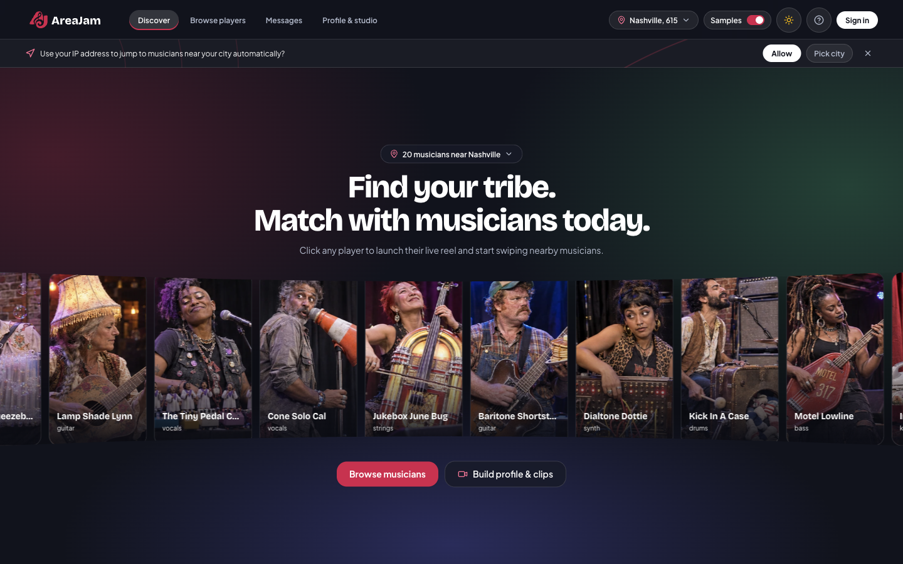
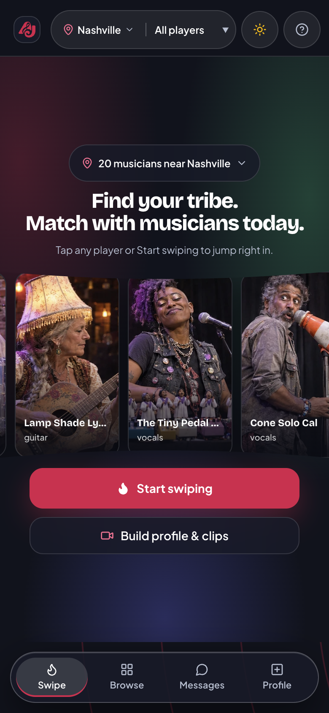
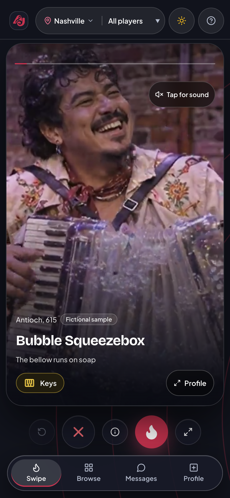
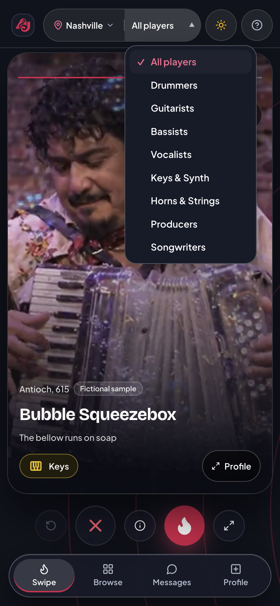
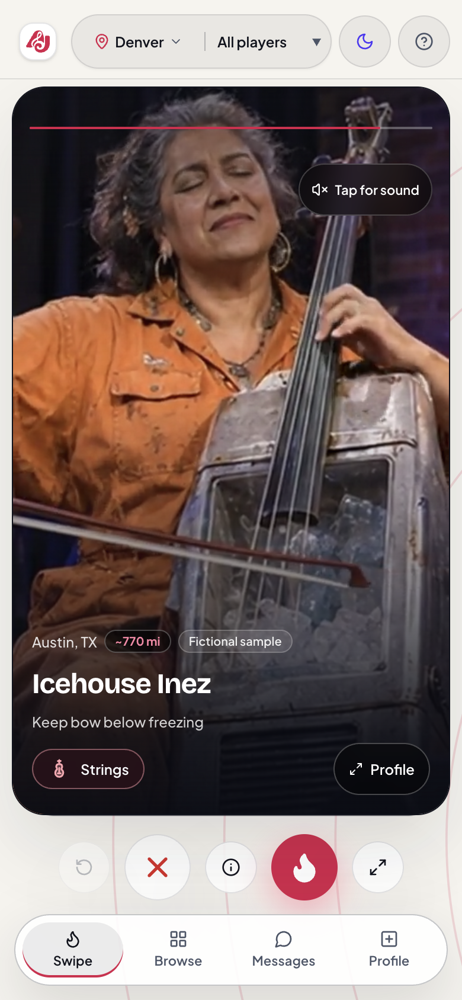
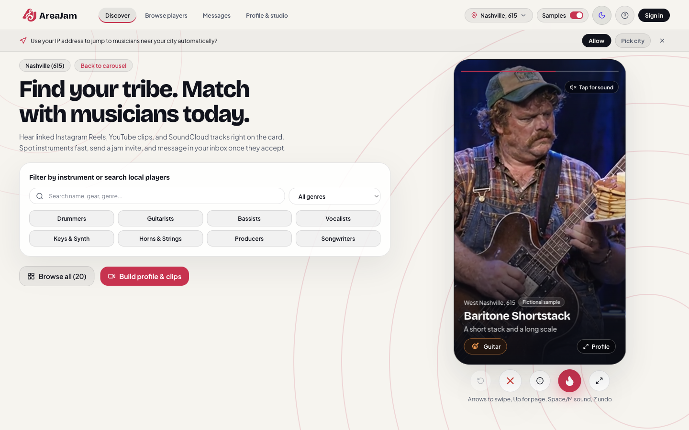
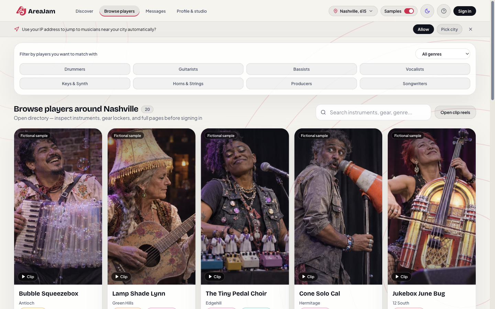
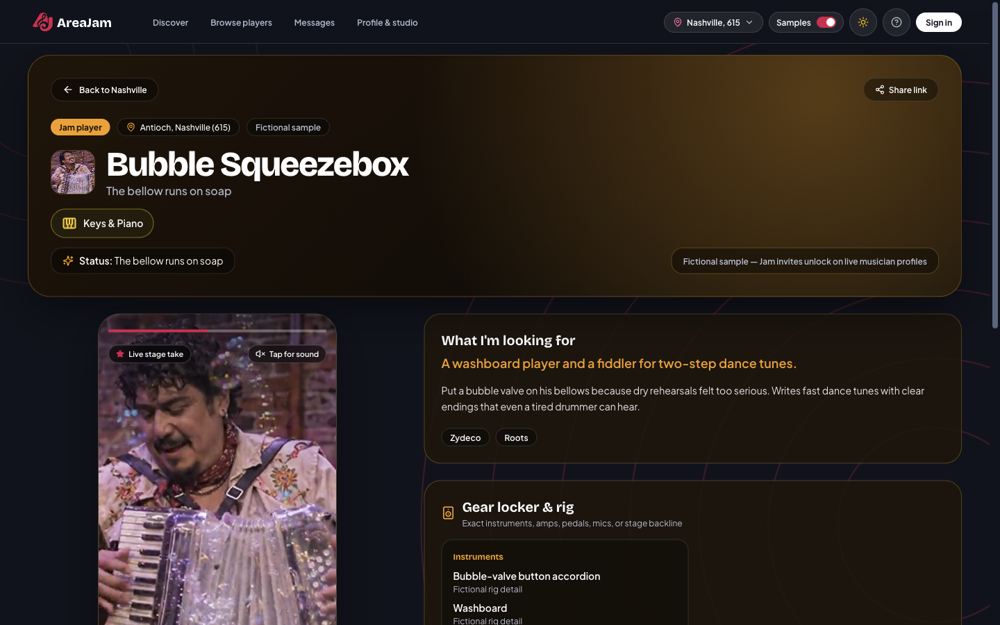
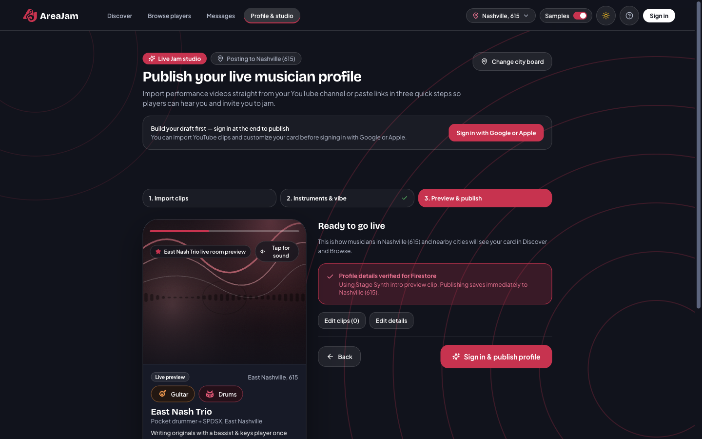

# AreaJam (`areajam.com`)

Local music discovery and musician matching PWA combining regional city boards, clip-first swipe discovery, rich artist profiles, and a match-gated Messages inbox — live at **[areajam.com](https://areajam.com/)**.

**[Read the full User Manual (`docs/USER_GUIDE.md`)](docs/USER_GUIDE.md)** for a complete feature walkthrough, keyboard shortcuts, FAQ, and mobile gestures.



## Visual Tour

### Mobile Experience (`390×844` — Single Top Bar & Full-Height Swipe)

<table>
  <tr>
    <td align="center">
      <br />
      <sub><strong>Landing Carousel</strong></sub>
    </td>
    <td align="center">
      <br />
      <sub><strong>Swipe Deck (Dark)</strong></sub>
    </td>
    <td align="center">
      <br />
      <sub><strong>Integrated Filter</strong></sub>
    </td>
    <td align="center">
      <br />
      <sub><strong>Swipe Deck (Light)</strong></sub>
    </td>
  </tr>
</table>

### Desktop Experience (`1440×900` — Swipe Stage, Directory, Artist Profile & Studio)

<table>
  <tr>
    <td align="center" width="50%">
      <br />
      <sub><strong>Discover Swipe Stage &amp; Multi-Filter Grid</strong></sub>
    </td>
    <td align="center" width="50%">
      <br />
      <sub><strong>Open Musician Directory</strong></sub>
    </td>
  </tr>
  <tr>
    <td align="center" width="50%">
      <br />
      <sub><strong>Artist Profile Page &amp; Gear Locker</strong></sub>
    </td>
    <td align="center" width="50%">
      <br />
      <sub><strong>3-Step Profile &amp; Studio Builder</strong></sub>
    </td>
  </tr>
</table>

## Core Features

- **Landing Carousel & Swipe Discovery:** Slowly scrolling concave carousel of nearby players that falls away straight into a Tinder-style stacked swipe deck with drag gestures, GSAP physics, and 5 circular action orbs (Undo, Pass, Quick Info, Jam Invite, Full Profile).
- **Focused Mobile Header:** On phones (`< 768px`), Location picking (`RegionDialog`) and Player Type filtering (`#mobile-player-type` using progressive `appearance: base-select`) live in one segmented header capsule so swipe cards get maximum screen height.
- **Regional Boards & Custom Towns:** Featured music metros, all 50 US states & DC, optional coarse IP-to-city auto-detection, neighboring-city fallback with rough distance estimates, and user-created town boards.
- **Open Directory & Shareable Artist Pages:** Anyone can search/filter players, audition clips, inspect categorized **Gear Lockers**, and open direct shareable links (`?p=<profile-id>`) before signing in.
- **3-Step Studio Onboarding:** Import clips from a public YouTube `@handle` or link Instagram Reels, YouTube, TikTok, Vimeo, SoundCloud, or direct MP4/MP3 URLs; customize page themes and statuses; draft freely before signing in to publish.
- **Matches & Messages Inbox:** Tinder-style **Matches** rail with `Inbox`, `Requests`, and `Sent` tabs. Accepting a jam request opens a direct 1-on-1 Cloud Firestore chat thread, backed by in-app **Block** and **Report** safety dialogs.

## Quick Controls (Desktop & Mobile)

| Control | Action |
| --- | --- |
| Drag card right / `ArrowRight` / Flame orb | Pass along or send a Jam invite |
| Drag card left / `ArrowLeft` / `X` orb | Pass on current musician |
| `ArrowUp` / Expand orb | Open full Artist Profile page |
| `Space` / `M` / **Tap for sound** | Mute or unmute clip audio |
| `Z` / Undo orb | Rewind last swipe |

Full walkthroughs live in **[`docs/USER_GUIDE.md`](docs/USER_GUIDE.md)**.

## Tech Stack

- **Frontend:** React 19, TypeScript, Vite 6, Tailwind CSS v4, GSAP, Lucide Icons
- **Backend & Security:** Firebase Auth (Google Sign-In + Apple config support), Cloud Firestore (`firestore.rules`, `firestore.indexes.json`), Firebase Storage rules (`storage.rules`)
- **Offline / PWA:** Custom service worker (`public/sw.js`), Web App Manifest, adaptive `light-dark()` theming

## Local Development

```bash
npm install
npm run dev
```

Type-check and build production static output (`dist/`):

```bash
npm run typecheck && npm run build
```

Preview the production bundle locally:

```bash
npm run preview
```

## Firebase Auth & Firestore Configuration

AreaJam points to Firebase project **`areajam-c3947`** by default (`src/lib/firebaseConfig.ts`), with `areajam.com`, `www.areajam.com`, and `localhost` listed in Authorized domains:
- **Google Sign-In:** Live (`Authentication` -> `Sign-in method` -> `Google`).
- **Apple Sign-In on Web:** Enabled in Firebase; requires adding your Apple Developer **Services ID**, **Team ID**, **Key ID**, and **Private Key** under **Firebase Console** -> **Authentication** -> **Sign-in method** -> **Apple** with return URL `https://areajam-c3947.firebaseapp.com/__/auth/handler`.
- **Custom Firebase Environment:** Copy `.env.example` and supply any `VITE_FIREBASE_*` overrides for your own project.

## Hosting via GitHub Pages (`areajam.com`)

1. The static production bundle (`dist/`, including `public/CNAME` -> `areajam.com`) is published on the `gh-pages` branch for GitHub Pages hosting.
2. Always commit and push changes to `main` before building with `VITE_BUILD_SHA` so the in-app **How AreaJam works** modal displays the exact source commit SHA.
3. Optional auto-deploy: move `docs/deploy-workflow.yml` to `.github/workflows/deploy.yml` via the GitHub web UI (or `gh auth refresh -s workflow`) to rebuild and deploy on pushes to `main`.
4. Under **GitHub** -> **Repo Settings** -> **Pages**, keep **Source** on **Deploy from a branch** (`gh-pages` / `/ (root)`) with **Enforce HTTPS** enabled.
